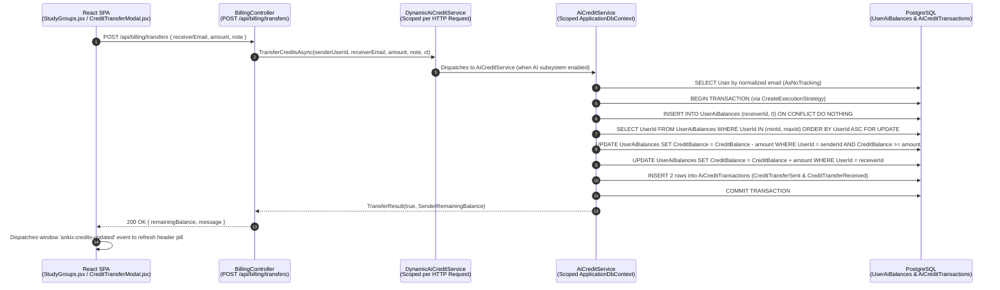

# AnkiX Vertical Slice Reference — AI Credit Ledger & P2P Transfers

> **Purpose:** Public-safe architectural trace generated from the `ankiX` monolith so sessions on any machine (including in Expedition Mode without the `ankiX` repo cloned) can reason about how `AiCreditService` interacts with the rest of the platform.

---

## 1. End-to-End Request Flow



---

## 2. Hop-by-Hop Platform Interactions (`file#lines` in `ankiX`)

### Hop 1: Frontend Caller (`src/frontend/src/`)
- **`pages/StudyGroups.jsx#L64, #L125, #L549, #L2350-L2353`** & **`components/CreditTransferModal.jsx#L1-L2`**:
  - Study Group admins/members open `CreditTransferModal` to sponsor contributors with AI credits.
  - Submits `POST /api/billing/transfers` via `api.js` and dispatches the custom DOM event `ankix:credits-updated` on completion so the sticky header telemetry pill refreshes without a page reload.

### Hop 2: API Controller (`src/backend/AnkiX.Api/Controllers/BillingController.cs`)
- **`BillingController.cs#L19-L41`**: Injects `IAiCreditService _creditService`.
- **`BillingController.cs#L194-L238` (`POST /api/billing/transfers`)**:
  - Extracts `senderUserId` from `ClaimTypes.NameIdentifier` JWT claim (`#L196-L200`).
  - Validates `ReceiverEmail` non-empty and `request.Amount >= AiPricingTiers.MinimumTransferAmount` (5 credits) before calling the service (`#L202-L210`).
  - Calls `_creditService.TransferCreditsAsync(senderUserId, request.ReceiverEmail, request.Amount, request.Note, ct)` (`#L212-L217`).
  - Maps `"Insufficient credit balance."` to `HTTP 402 PaymentRequired` (`code = "INSUFFICIENT_CREDITS"`), `"Receiver user account not found."` to `HTTP 404 NotFound`, and other failures to `HTTP 400 BadRequest` (`#L219-L232`).
- **Other Upstream Callers of `IAiCreditService.DeductCreditsAsync`**:
  - `Controllers/CardsAiAssistantController.cs#L25-L32` (deducts credits after Gemini card refinement).
  - `Controllers/DocumentsAiController.cs#L25-L34` (pre-flight checks and deducts unit-based credits for PDF/YouTube ingestion).
  - `Controllers/StudyGroupsController.cs#L29-L36` (grants idempotent welcome credits on first study group creation).
  - `Controllers/AdminUsersController.cs#L45-L63` (super-admin promotional credit grants).

### Hop 3: Dependency Injection & Lifetime (`src/backend/AnkiX.Api/Extensions/AiModuleExtensions.cs`)
- **`AiModuleExtensions.cs#L16-L18`**:
  ```csharp
  services.AddScoped<AiCreditService>();
  services.AddScoped<NullAiCreditService>();
  services.AddScoped<IAiCreditService, DynamicAiCreditService>();
  ```
- **Crucial Concurrency Implication:**
  - In production ASP.NET Core, each incoming HTTP request gets its own DI scope, which means **each concurrent HTTP request gets its own separate `ApplicationDbContext` instance and database connection**.
  - However, inside `AiCreditService.cs#L11`, `private static readonly SemaphoreSlim _inMemoryLock = new(1, 1);` is `static` (process-wide singleton), used only when `_dbContext.Database.IsRelational()` is `false` (EF Core `UseInMemoryDatabase` in unit tests).

### Hop 4: Core Service (`src/backend/AnkiX.Api/Services/AiCreditService.cs`)
- **Single-Row Deduction (`DeductCreditsAsync`, `#L40-L177`)**:
  - **Relational branch (`#L77-L138`)**: Wraps execution in `_dbContext.Database.CreateExecutionStrategy()` and a database transaction. Runs an atomic conditional update:
    ```sql
    UPDATE "UserAiBalances"
    SET "CreditBalance" = "CreditBalance" - @cost,
        "LifetimeConsumed" = "LifetimeConsumed" + @cost,
        "UpdatedAt" = @now
    WHERE "UserId" = @userId AND "CreditBalance" >= @cost
    ```
    If `rowsAffected == 0`, rolls back and returns `INSUFFICIENT_CREDITS`. Otherwise reads the updated balance and inserts an `AiCreditTransaction` audit row (`Amount = -cost`).
  - **In-Memory fallback (`#L140-L176`)**: Acquires `_inMemoryLock.WaitAsync(ct)`, reads `UserAiBalances` via EF LINQ, subtracts in C# memory, and calls `SaveChangesAsync`.
- **Two-Row Peer-to-Peer Transfer (`TransferCreditsAsync`, `#L422-L545`)**:
  - **Lock ordering helper (`#L422-L425`)**:
    ```csharp
    public static (int FirstUserId, int SecondUserId) GetDeterministicLockOrder(int userIdA, int userIdB)
        => userIdA < userIdB ? (userIdA, userIdB) : (userIdB, userIdA);
    ```
  - **Relational branch (`#L467-L545`)**:
    1. Upserts receiver balance row so `FOR UPDATE` has a tuple to lock (`#L475-L478`):
       ```sql
       INSERT INTO "UserAiBalances" ("UserId", "CreditBalance", "LifetimePurchased", "LifetimeConsumed", "UpdatedAt")
       VALUES (@receiverId, 0, 0, 0, @now)
       ON CONFLICT ("UserId") DO NOTHING
       ```
    2. Acquires row-level `FOR UPDATE` locks in ascending `UserId` order (`#L481-L485`):
       ```sql
       SELECT "UserId" FROM "UserAiBalances"
       WHERE "UserId" IN (@firstLockUserId, @secondLockUserId)
       ORDER BY "UserId" ASC
       FOR UPDATE
       ```
    3. Deducts from sender via atomic conditional `UPDATE ... WHERE "UserId" = @senderUserId AND "CreditBalance" >= @amount` (`#L488-L499`).
    4. Credits receiver via `UPDATE ... SET "CreditBalance" = "CreditBalance" + @amount WHERE "UserId" = @receiverId` (`#L507-L511`).
    5. Appends two `AiCreditTransaction` audit rows (`CreditTransferSent` with `-amount`, `CreditTransferReceived` with `+amount`) and commits (`#L519-L543`).

### Hop 5: Database Schema & Constraints (`src/backend/AnkiX.Api/Data/ApplicationDbContext.cs`)
- **`ApplicationDbContext.cs#L154-L161` (`UserAiBalance`)**:
  - Primary Key: `UserId` (clustered/B-Tree index used by `WHERE "UserId" = ...` and `FOR UPDATE`).
  - Check Constraint: `CK_UserAiBalances_CreditBalance_NonNegative` enforces `"CreditBalance" >= 0` at the PostgreSQL table level as a final safety net.
- **`ApplicationDbContext.cs#L163-L172` (`AiCreditTransaction`)**:
  - Primary Key: `Id`.
  - Indexes on `UserId`, `ActionType`, `ReferenceId`, `CreatedAt`, `(UserId, ActionType)`, plus a filtered unique index `IX_AiCreditTransactions_UserId_FirstGroupGrant_Unique` where `"ActionType" = 'FirstGroupCreationGrant'`.

### Hop 6: Existing Test Suite (`src/backend/AnkiX.Api.Tests/AiCreditServiceTests.cs`)
- **`AiCreditServiceTests.cs#L12-L19`**: Uses `UseInMemoryDatabase(Guid.NewGuid().ToString())`.
- **`AiCreditServiceTests.cs#L201-L243` (Parallel Deduction Test)**:
  - Spawns 20 `Task.Run` tasks against a single `AiCreditService(db)` sharing **one** `ApplicationDbContext`.
  - Passes only because `UseInMemoryDatabase` takes the `_inMemoryLock` (`SemaphoreSlim(1,1)`) branch, serializing all 20 calls in C# memory and completely bypassing the relational SQL in `#L77-L138` and `#L467-L545`.
